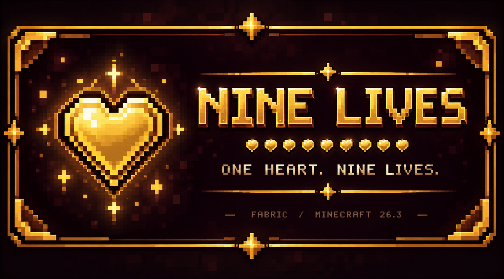
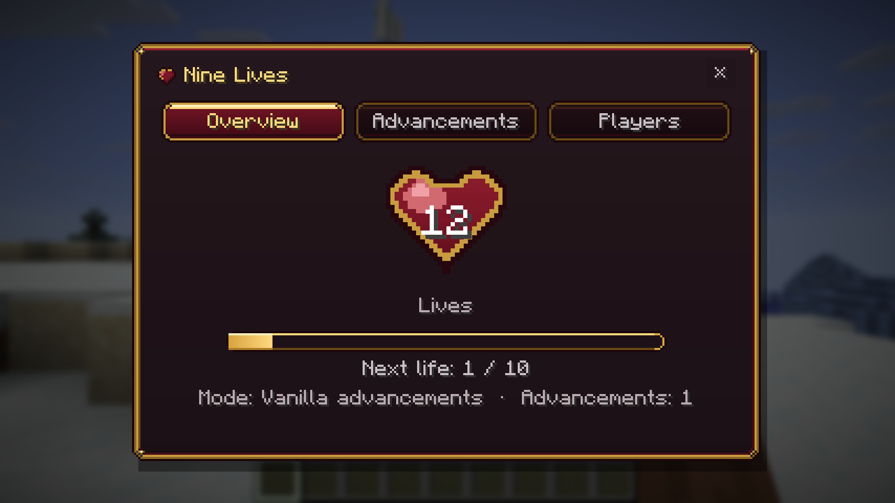
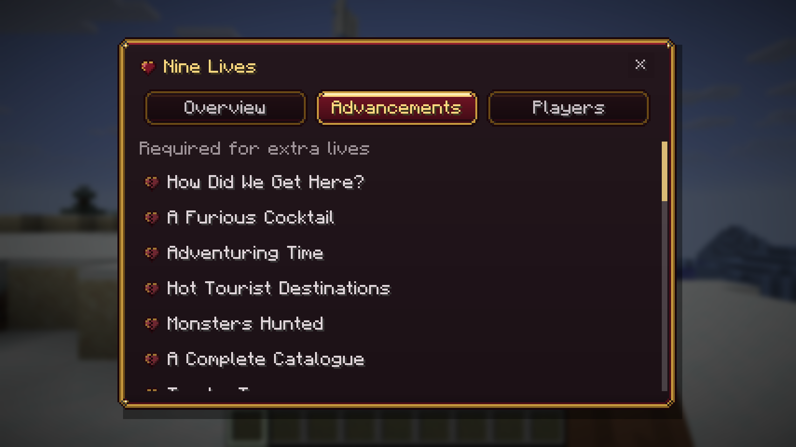
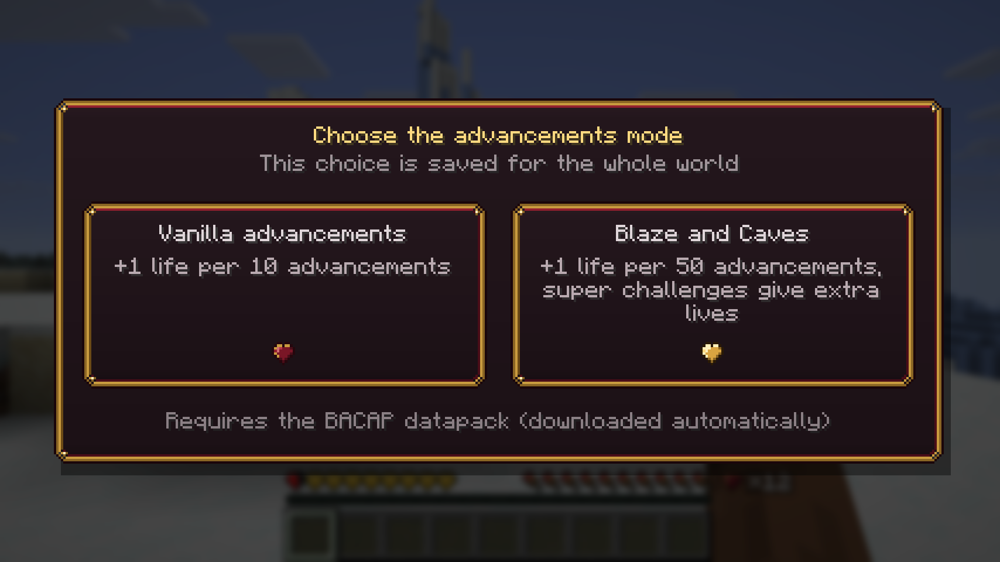
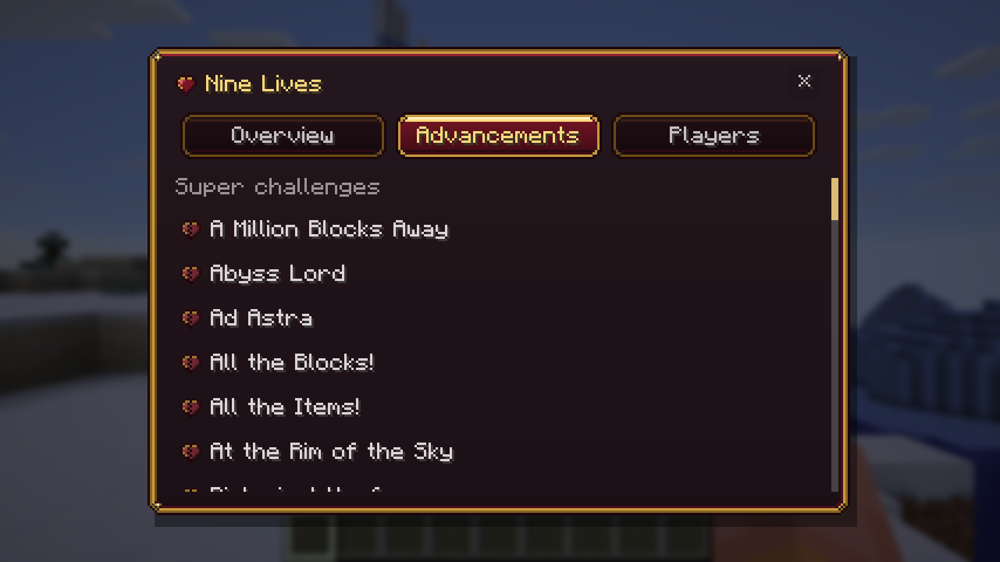

# Nine Lives

[](https://www.minecraft.net)
[](https://fabricmc.net)
[](https://modrinth.com/mod/ninelives)
[](LICENSE)
[](#ai-disclosure)

**Everyone has exactly one heart.** Max health is locked at 1 HP — food, enchants,
effects, attribute modifiers and commands cannot raise it, while absorption, golden
apples and totems work like vanilla. Lives are earned with advancements, spent on
death, and can be given to friends. At zero lives you become a spectator until
someone transfers a life to you.

A Fabric mod for **Minecraft 26.3** (Java 25, Fabric Loader 0.20.1+, Fabric API).

[Русская версия](#русская-версия)

## Screenshots

<table>
<tr>
<td width="50%"></td>
<td width="50%"></td>
</tr>
<tr>
<td></td>
<td></td>
</tr>
</table>

## Features

- **1 HP cap.** Absorption hearts, golden apples, totems and the Health Boost effect
  keep working; everything else cannot exceed half a heart.
- **9 starting lives.** Death spends one life (a totem save does not). Lives never
  have an upper bound.
- **15 seconds of respawn protection**, cancelled early if you attack.
- **0 lives → spectator.** The only way back is a life transfer from another player.
- **Life transfer.** `/ninelives give` opens a card UI, the giver always keeps at
  least one life, spectators can be revived.
- **Two advancement modes.** Vanilla: +1 life per 10 advancements plus +1 for each of
  13 curated hard advancements. Blaze and Caves: +1 per 50 BACAP advancements plus +1
  for every super challenge. Each advancement counts once, forever.
- **BACAP auto-install.** Picking the BACAP mode downloads the datapack from Modrinth
  on the server, verifies the SHA-1 from the API response, enables it and reloads —
  no manual downloads, no confirmation dialog. Only allow-listed official domains are
  contacted and the datapack is never bundled in the jar.
- **Vanilla clients can join.** The server-only jar keeps every custom packet behind
  a handshake; players without the mod get Tab/chat/action bar feedback.
- **Dark glass burgundy-and-gold UI** with RU/EN localization, animated HUD, toasts,
  particles and sounds (full jar only).

## Installation

Requirements: Minecraft **26.3**, Fabric Loader **0.20.1+**, Fabric API, Java **25**.
Mod Menu is optional (client settings screen).

**Download:** [GitHub Releases](https://github.com/reystin/nine-lives/releases/latest) or [Modrinth](https://modrinth.com/mod/ninelives).

| Build | File | Where to install |
|---|---|---|
| Full (client + server) | `ninelives-1.0.0+mc26.3.jar` | Server **and every player**, or just `mods/` in singleplayer. Includes the whole interface. |
| Server-only | `ninelives-server-1.0.0+mc26.3.jar` | **Server only.** Vanilla clients join: Tab shows `♥12 · ★45 Name`, plus chat, action bar and titles. |

Both builds come from the same source. The server jar physically excludes client
classes, client textures and the client mixin config.

## Commands

```
/ninelives get|info [player]          status
/ninelives give <player> [amount]     transfer lives (giver keeps at least 1)
/ninelives set|add|reset <player> [n] operator
/ninelives mode <vanilla|bc|clear>    operator (clear selects again)
/ninelives datapack status|install    operator
/ninelives config reload              operator
```

## Advancement modes

- `vanilla` — +1 life per 10 advancements (configurable) and +1 for each of 13
  curated hard advancements (all effects, all potions, all biomes, all mobs, all
  cats/wolves/animals, balanced diet, dragon, full beacon, all armor trims, ...).
- `bc` — Blaze and Caves: +1 life per 50 BACAP advancements and +1 per super
  challenge. The datapack is downloaded automatically when the mode is selected or
  when a host/operator joins a world that already uses this mode without the pack.

The mode is chosen by the world host (first-join screen) or an operator. Until it is
chosen, `defaultMode` from the config applies. Counter resets and re-selection are
available to operators.

## Configuration

Server: `config/ninelives.json` — advancements per life for both modes, hard list,
super challenges, BACAP tab root, respawn protection duration, default mode, server
message language (en/ru), download allow-list, vanilla fallback on install failure.

Client (full jar): `config/ninelives-client.json` — HUD, animations, particles,
sounds, UI scale. Settings screen via Mod Menu.

## Building

```bash
./gradlew build -Pvariant=full    # build/libs/ninelives-1.0.0+mc26.3.jar
./gradlew build -Pvariant=server  # build/libs/ninelives-server-1.0.0+mc26.3.jar
```

Development runs:

```bash
./gradlew runClient           # client with the mod
./gradlew runServer           # dedicated server
./gradlew runGametestServer   # 26 Fabric game tests (report: run/gametest-report.xml)
./gradlew runShowcaseClient   # auto screenshots of the UI (run/screenshots)
```

The codebase is split into `src/main` (shared and server logic; works without the
client part) and `src/client` (full interface, only in the full jar). The server is
authoritative; modded clients receive state over `ninelives:*` channels and vanilla
clients play through standard server features.

`tools/gen_textures.py` regenerates the in-game pixel-art textures, and
`tools/make_branding.py` renders the icon and banner. Neither is packaged into the jar.

## AI disclosure

This project is developed **with AI assistance** (Qoder). The author defines the
design, reviews every change, runs the game tests and verifies the in-game behavior.
AI-assisted tooling is disclosed here, in the repository topics and in the Modrinth
listing. Branding and textures are generated procedurally by the scripts above, not
by an image model.

## License

[MIT](LICENSE) © 2026 reystin.

---

## Русская версия

**У всех игроков ровно одно сердце.** Максимум здоровья зафиксирован на 1 HP: еда,
зачарования, эффекты, модификаторы атрибутов и команды не могут его поднять, а
поглощение, золотые яблоки и тотемы работают как в ванили. Жизни зарабатываются
достижениями, тратятся на смерть и передаются другим игрокам. При нуле жизней игрок
становится наблюдателем, пока ему не передадут жизнь.

Fabric-мод для **Minecraft 26.3** (Java 25, Fabric Loader 0.20.1+, Fabric API).

### Установка

| Сборка | Файл | Куда ставить |
|---|---|---|
| Полная (клиент + сервер) | `ninelives-1.0.0+mc26.3.jar` | На сервер **и каждому игроку**. Включает весь интерфейс: экран жизней, HUD, тосты, анимации. В одиночной игре — просто в `mods` |
| Серверная | `ninelives-server-1.0.0+mc26.3.jar` | **Только на сервер.** У игроков ванильный клиент: Tab с жизнями (`♥12 · ★45 Ник`), чат, action bar, title |

Клиент без мода подключается к серверу с любой сборкой без ошибок и кика: все
кастомные пакеты шлются только клиентам с модом (handshake при входе).

### Геймплей

- **Старт: 9 жизней**, максимума нет.
- **Смерть тратит одну жизнь** (тотем — не тратит).
- **Защита после возрождения**: 15 с неуязвимости; снимается досрочно атакой.
- **0 жизней** → режим наблюдателя; вернуться можно только передачей жизни.

### Режимы достижений

- **Ванильные** (`vanilla`): +1 жизнь за каждые 10 достижений и +1 за каждое из
  13 курируемых хард-достижений.
- **Blaze and Caves** (`bc`): +1 жизнь за каждые 50 достижений BACAP и +1 за каждый
  супер-челлендж. Датапак сразу скачивается с Modrinth, проверяется по SHA-1 из
  ответа API и включается без выхода из мира. Разрешены только официальные домены
  из конфига, в jar датапак не входит.

Режим выбирается хостом мира (экран при первом входе) или оператором. Пока режим не
выбран, действует `defaultMode` из конфига.

### Анти-накрутка

Каждое достижение засчитывается один раз за всё время (id хранятся на игроке и
переживают revoke, смерть и перезаход). Считаются только достижения с отображением,
кроме корней вкладок. Прогресс до установки мода импортируется при первом входе.

### Команды

```
/ninelives get|info [игрок]              — статус
/ninelives give <игрок> [кол-во]         — передать жизни (у отдающего остаётся ≥1)
/ninelives set|add|reset <игрок> [n]     — оператор
/ninelives mode <vanilla|bc|clear>       — оператор (clear — выбор заново)
/ninelives datapack status|install       — оператор
/ninelives config reload                 — оператор
```

### Конфиг

`config/ninelives.json` (сервер): число достижений на жизнь, хард-список,
супер-челленджи, корень вкладки BACAP, длительность защиты, режим по умолчанию, язык
серверных сообщений, разрешённые домены загрузки.

`config/ninelives-client.json` (клиент полной сборки): HUD, анимации, частицы, звуки,
масштаб интерфейса. Экран настроек — через Mod Menu.

### Сборка и тесты

```bash
./gradlew build -Pvariant=full      # build/libs/ninelives-1.0.0+mc26.3.jar
./gradlew build -Pvariant=server    # build/libs/ninelives-server-1.0.0+mc26.3.jar
./gradlew runGametestServer         # 26 геймтестов Fabric
./gradlew runShowcaseClient         # автоскриншоты интерфейса
```

### Сделано с помощью ИИ

Проект разрабатывается **с использованием ИИ** (Qoder). Автор задаёт дизайн,
проверяет каждое изменение, запускает геймтесты и проверяет поведение в игре.
Пометка указана здесь, в темах репозитория и в описании на Modrinth. Текстуры и
брендинг генерируются процедурно скриптами `tools/`, а не графической ИИ-моделью.

### Лицензия

[MIT](LICENSE) © 2026 reystin.
